# 02 — Database Design (MVP)

> **Status:** Approved 2026-08-10 (decisions D1–D10) · **Engine:** PostgreSQL 15+ (Supabase-hosted) · **ORM:** Prisma
> **Scope rule:** only what the MVP in [`01_MVP_REQUIREMENTS.md`](01_MVP_REQUIREMENTS.md) requires — designed so later phases are additive, never a rewrite.

---

## 1. Conventions

| Rule           | Decision                                                                                                                   |
| -------------- | -------------------------------------------------------------------------------------------------------------------------- |
| Primary keys   | UUID v7 (`gen_random_uuid()` at MVP; migrate to v7 generator in app layer for index locality). Never expose sequential ids |
| Money          | `BigInt` **poisha** (1 BDT = 100 poisha). Never `Float`, never `Decimal` for money. Column names end in `Poisha`           |
| Quantity       | `BigInt` in the product's **base unit** (milligrams, millilitres, or pieces). Column names end in `Base`. See §6.1         |
| Time           | `timestamptz`, UTC in the database, rendered in `Asia/Dhaka` (UTC+6) in the UI                                             |
| Naming         | Tables `snake_case` plural via `@@map`; Prisma models `PascalCase` singular; enums `SCREAMING_SNAKE`                       |
| Deletes        | No hard deletes on any financial, order, or identity record. `deletedAt` + status enums                                    |
| Money mutation | Only through the ledger (§9). No table stores a balance that is not derivable from ledger entries                          |
| Timestamps     | Every table has `createdAt`; mutable tables have `updatedAt`                                                               |
| Concurrency    | Rows subject to concurrent mutation carry an integer `version` for optimistic locking                                      |

### 1.1 Rounding rule (normative)

Line totals are computed with exact integer arithmetic:

```text
lineTotalPoisha = roundHalfUp( unitPricePoisha × quantityBase , saleUnitInBaseUnits )

  = ( unitPricePoisha × quantityBase + saleUnitInBaseUnits / 2 ) / saleUnitInBaseUnits   [integer division]
```

Rounding happens **once, at the line level**. Order totals are sums of already-rounded lines. Fees are computed on the rounded subtotal and rounded half-up individually. Any residual from percentage splits is assigned to the **platform**, never to the farmer or the buyer — documented in [`06_FINANCIAL_ARCHITECTURE.md`](06_FINANCIAL_ARCHITECTURE.md) §4.

---

## 2. Entity map

```mermaid
erDiagram
    USER ||--o{ USER_ROLE_ASSIGNMENT : has
    USER ||--o| FARMER_PROFILE : may_have
    USER ||--o| CONSUMER_PROFILE : may_have
    USER ||--o| RETAILER_PROFILE : may_have
    USER ||--o{ ADDRESS : owns
    USER ||--o{ VERIFICATION_REQUEST : submits

    FARMER_PROFILE ||--o{ FARM : operates
    FARM ||--o{ LISTING : offers
    PRODUCT_CATEGORY ||--o{ PRODUCT : contains
    PRODUCT ||--o{ PRODUCT_VARIETY : has
    PRODUCT ||--o{ LISTING : typed_as
    LISTING ||--o{ LISTING_IMAGE : has
    LISTING ||--o{ LISTING_RESERVATION : holds

    USER ||--o{ CART : keeps
    CART ||--o{ CART_ITEM : contains
    LISTING ||--o{ CART_ITEM : referenced_by

    USER ||--o{ ORDER_QUOTE : requests
    ORDER_QUOTE ||--o| ORDER : materialises
    ORDER ||--|{ ORDER_ITEM : contains
    ORDER ||--o{ ORDER_EVENT : logs
    ORDER ||--o| DELIVERY : fulfilled_by
    ORDER ||--o{ PAYMENT : paid_by
    ORDER ||--o{ REFUND : refunded_by
    ORDER ||--o{ REVIEW : rated_in
    ORDER ||--o{ DISPUTE : disputed_in

    LEDGER_TRANSACTION ||--|{ LEDGER_ENTRY : balances
    LEDGER_ACCOUNT ||--o{ LEDGER_ENTRY : posts_to
    SETTLEMENT ||--|{ SETTLEMENT_ITEM : aggregates
    FARMER_PROFILE ||--o{ SETTLEMENT : paid_by

    DELIVERY_TRIP ||--|{ TRIP_STOP : routes
    DELIVERY_TRIP ||--o{ TRIP_COST_ITEM : costed_by
    DELIVERY_TRIP ||--o{ DELIVERY : carries

    ORDER ||--o| ORDER_ECONOMICS : measured_by
    ORDER ||--o{ BASELINE_SNAPSHOT : benchmarked_against
    PRICE_OBSERVATION }o--|| PRODUCT : prices
    EXPERIMENT ||--o{ EXPERIMENT_ASSIGNMENT : assigns

    ADMIN_AREA ||--o{ ADMIN_AREA : parent_of
    ADMIN_AREA ||--o{ ADDRESS : locates
    ADMIN_AREA ||--o{ FARM : locates
    ADMIN_AREA ||--o{ PRICE_OBSERVATION : scopes
    ADMIN_AREA ||--o| GEOGRAPHY_CANDIDATE_ASSESSMENT : evaluated_by
```



---

## 3. Schema — identity and access

```prisma
enum UserStatus       { ACTIVE  SUSPENDED  DEACTIVATED }
enum Role             { FARMER  CONSUMER  RETAILER  OPS_AGENT  ADMIN }
enum Language         { BN  EN }
enum VerificationStatus { UNVERIFIED  PENDING  VERIFIED  REJECTED }

model User {
  id               String     @id @default(uuid())
  phone            String     @unique                 // E.164, +8801XXXXXXXXX
  phoneVerifiedAt  DateTime?
  email            String?    @unique
  fullName         String
  preferredLanguage Language  @default(BN)
  status           UserStatus @default(ACTIVE)
  lastLoginAt      DateTime?
  createdAt        DateTime   @default(now())
  updatedAt        DateTime   @updatedAt
  deletedAt        DateTime?

  roles            UserRoleAssignment[]
  addresses        Address[]
  farmerProfile    FarmerProfile?
  consumerProfile  ConsumerProfile?
  retailerProfile  RetailerProfile?

  @@index([status])
  @@map("users")
}

model UserRoleAssignment {
  id          String   @id @default(uuid())
  userId      String
  role        Role
  grantedAt   DateTime @default(now())
  grantedById String?                                  // null = self-selected at signup
  revokedAt   DateTime?

  user        User     @relation(fields: [userId], references: [id])

  @@unique([userId, role])
  @@index([role])
  @@map("user_role_assignments")
}

/// Short-lived OTP challenge. Code is stored hashed; never in plaintext.
model OtpChallenge {
  id          String   @id @default(uuid())
  phone       String
  codeHash    String                                   // argon2id / bcrypt
  purpose     String                                   // LOGIN | PHONE_CHANGE | DELIVERY_CONFIRM
  expiresAt   DateTime
  attempts    Int      @default(0)
  consumedAt  DateTime?
  requestIp   String?
  createdAt   DateTime @default(now())

  @@index([phone, purpose, createdAt])
  @@map("otp_challenges")
}

model VerificationRequest {
  id            String             @id @default(uuid())
  subjectUserId String
  subjectType   String                                 // FARMER | RETAILER
  status        VerificationStatus @default(PENDING)
  submittedAt   DateTime           @default(now())
  reviewedById  String?
  reviewedAt    DateTime?
  rejectionReason String?

  documents     VerificationDocument[]

  @@index([status, submittedAt])
  @@map("verification_requests")
}

model VerificationDocument {
  id                    String   @id @default(uuid())
  verificationRequestId String
  documentType          String                         // NID_FRONT | NID_BACK | LAND_DOC | TRADE_LICENCE | SELFIE
  storageKey            String                         // private bucket object key
  sha256                String
  mimeType              String
  sizeBytes             Int
  createdAt             DateTime @default(now())

  request VerificationRequest @relation(fields: [verificationRequestId], references: [id])

  @@map("verification_documents")
}

model AuditLog {
  id           String   @id @default(uuid())
  actorUserId  String?
  actorRole    Role?
  action       String                                  // ORDER_CANCELLED, FARMER_VERIFIED, ...
  entityType   String
  entityId     String
  before       Json?
  after        Json?
  reason       String?
  requestId    String?
  ipAddress    String?
  userAgent    String?
  createdAt    DateTime @default(now())

  @@index([entityType, entityId, createdAt])
  @@index([actorUserId, createdAt])
  @@map("audit_logs")
}
```

**Note on NID.** National ID numbers are high-sensitivity PII. The MVP stores a **hash** for duplicate detection plus the document image in a private bucket; the plaintext number is not stored in a queryable column. See [`07_SECURITY.md`](07_SECURITY.md) §9 and [`08_BANGLADESH_CONTEXT.md`](08_BANGLADESH_CONTEXT.md) §7.6.

---

## 4. Schema — geography and addresses

```prisma
enum AdminAreaType    { DIVISION  DISTRICT  UPAZILA  UNION }
enum LocationPrecision { EXACT  APPROXIMATE  AREA_CENTROID }

/// Seeded reference data: 8 divisions → 64 districts → ~495 upazilas → ~4,500 unions.
model AdminArea {
  id           String        @id @default(uuid())
  type         AdminAreaType
  parentId     String?
  nameEn       String
  nameBn       String
  code         String?       @unique                   // official statistical code where available
  centroidLat  Decimal?      @db.Decimal(9, 6)
  centroidLng  Decimal?      @db.Decimal(9, 6)
  isActive     Boolean       @default(true)

  parent       AdminArea?    @relation("AreaTree", fields: [parentId], references: [id])
  children     AdminArea[]   @relation("AreaTree")

  @@index([type, parentId])
  @@index([parentId, nameEn])
  @@map("admin_areas")
}

model Address {
  id             String            @id @default(uuid())
  userId         String
  label          String?                                // "Home", "Shop"
  recipientName  String
  recipientPhone String
  adminAreaId    String                                 // union (preferred) or upazila
  villageOrArea  String?
  addressLine    String
  landmark       String?
  latitude       Decimal?          @db.Decimal(9, 6)
  longitude      Decimal?          @db.Decimal(9, 6)
  precision      LocationPrecision @default(AREA_CENTROID)
  isDefault      Boolean           @default(false)
  createdAt      DateTime          @default(now())
  updatedAt      DateTime          @updatedAt
  deletedAt      DateTime?

  user           User              @relation(fields: [userId], references: [id])
  area           AdminArea         @relation(fields: [adminAreaId], references: [id])

  @@index([userId, isDefault])
  @@map("addresses")
}
```

**Geospatial handling.** Prisma has no native PostGIS type. The pattern:

```sql
CREATE EXTENSION IF NOT EXISTS postgis;

ALTER TABLE listings
  ADD COLUMN geo geography(Point, 4326)
  GENERATED ALWAYS AS (
    CASE WHEN longitude IS NOT NULL AND latitude IS NOT NULL
      THEN ST_SetSRID(ST_MakePoint(longitude::float8, latitude::float8), 4326)::geography
    END
  ) STORED;

CREATE INDEX listings_geo_gix ON listings USING GIST (geo);
```

The column is declared `Unsupported("geography")?` in Prisma (readable, not writable) and radius search runs through a typed raw query in the repository layer:

```sql
SELECT id, ST_Distance(geo, $1::geography) AS distance_m
FROM listings
WHERE status = 'PUBLISHED'
  AND ST_DWithin(geo, $1::geography, $2)
  AND available_to >= now()
  AND quantity_available_base > 0;
```

**Why not haversine in SQL:** it prevents index usage and forces a full scan. `ST_DWithin` on a GIST index does not. This matters at 10k listings, not 100 — but the migration cost later is higher than the setup cost now.

**Rural addressing reality:** many rural addresses have no map-able street address. The `AdminArea` hierarchy is the primary key to location; the map pin is an enhancement. `precision` records which one we actually have, so distance-based pricing can widen its error bars honestly rather than pretend to metre accuracy. See [`08_BANGLADESH_CONTEXT.md`](08_BANGLADESH_CONTEXT.md) §2.

---

## 5. Schema — profiles

```prisma
model FarmerProfile {
  id                String             @id @default(uuid())
  userId            String             @unique
  displayName       String
  bio               String?
  verificationStatus VerificationStatus @default(UNVERIFIED)
  verifiedAt        DateTime?
  nidHash           String?            @unique          // duplicate detection only
  settlementRail    SettlementRail  @default(AGENT_CASH)
  payoutAccountRef  String?                             // encrypted at rest, app-layer envelope
  payoutAccountName String?
  payoutVerifiedAt  DateTime?
  payoutChangedAt   DateTime?                           // drives the post-change settlement hold

  // Settlement risk tiering — governs the hold between delivery and payout (D5, Q2)
  riskTier          String          @default("NEW")     // NEW | STANDARD | TRUSTED
  settlementHoldHoursOverride Int?

  // Derived reputation — recomputed, never authoritative for money
  ratingAverage     Decimal            @default(0) @db.Decimal(3, 2)
  ratingCount       Int                @default(0)
  ordersAccepted    Int                @default(0)
  ordersCompleted   Int                @default(0)
  ordersCancelledBySeller Int          @default(0)
  reliabilityScore  Decimal            @default(0.5) @db.Decimal(4, 3)

  createdAt         DateTime           @default(now())
  updatedAt         DateTime           @updatedAt

  user              User               @relation(fields: [userId], references: [id])
  farms             Farm[]
  listings          Listing[]

  @@index([verificationStatus])
  @@map("farmer_profiles")
}

model ConsumerProfile {
  id               String   @id @default(uuid())
  userId           String   @unique
  defaultAddressId String?
  createdAt        DateTime @default(now())
  user             User     @relation(fields: [userId], references: [id])
  @@map("consumer_profiles")
}

model RetailerProfile {
  id                 String             @id @default(uuid())
  userId             String             @unique
  businessName       String
  businessType       String?                             // GROCERY | RESTAURANT | HOTEL | INSTITUTION
  tradeLicenceNumber String?
  binNumber          String?                             // VAT registration
  verificationStatus VerificationStatus @default(UNVERIFIED)
  createdAt          DateTime           @default(now())
  user               User               @relation(fields: [userId], references: [id])
  @@map("retailer_profiles")
}
```

---

## 6. Schema — farms, catalogue, listings

```prisma
enum BaseUnit         { MILLIGRAM  MILLILITRE  PIECE }   // see §6.1
enum SaleUnit         { KG  GRAM  MILLIGRAM  MON  SEER  PIECE  HALI  DOZEN  LITRE  MILLILITRE }
enum PerishabilityClass { HIGHLY_PERISHABLE  PERISHABLE  SEMI_DURABLE  DURABLE }
enum ListingStatus    { DRAFT  PENDING_REVIEW  PUBLISHED  PAUSED  SOLD_OUT  EXPIRED  REMOVED }
enum QualityGrade     { A  B  C  UNGRADED }

model Farm {
  id              String            @id @default(uuid())
  farmerProfileId String
  name            String
  adminAreaId     String
  villageOrArea   String?
  addressLine     String?
  latitude        Decimal?          @db.Decimal(9, 6)
  longitude       Decimal?          @db.Decimal(9, 6)
  precision       LocationPrecision @default(AREA_CENTROID)
  landAreaDecimals Int?                                  // BD "decimal" = 1/100 acre ≈ 40.46 m²
  createdAt       DateTime          @default(now())
  updatedAt       DateTime          @updatedAt
  deletedAt       DateTime?

  farmer          FarmerProfile     @relation(fields: [farmerProfileId], references: [id])
  area            AdminArea         @relation(fields: [adminAreaId], references: [id])
  listings        Listing[]

  @@index([farmerProfileId])
  @@index([adminAreaId])
  @@map("farms")
}

model ProductCategory {
  id        String    @id @default(uuid())
  slug      String    @unique
  nameEn    String
  nameBn    String
  sortOrder Int       @default(0)
  isActive  Boolean   @default(true)
  products  Product[]
  @@map("product_categories")
}

/// Curated catalogue. Farmers pick from it; they do not invent free-text products.
/// Rationale: comparable listings, working search, usable price observations.
model Product {
  id                  String             @id @default(uuid())
  categoryId          String
  slug                String             @unique
  nameEn              String
  nameBn              String
  baseUnit            BaseUnit
  defaultSaleUnit     SaleUnit
  perishability       PerishabilityClass
  defaultShelfLifeHours Int
  imageKey            String?
  isActive            Boolean            @default(true)

  category            ProductCategory    @relation(fields: [categoryId], references: [id])
  varieties           ProductVariety[]
  listings            Listing[]

  @@index([categoryId, isActive])
  @@map("products")
}

model ProductVariety {
  id        String  @id @default(uuid())
  productId String
  nameEn    String
  nameBn    String
  isActive  Boolean @default(true)
  product   Product @relation(fields: [productId], references: [id])
  @@unique([productId, nameEn])
  @@map("product_varieties")
}

model Listing {
  id                 String            @id @default(uuid())
  farmId             String
  farmerProfileId    String
  productId          String
  varietyId          String?
  grade              QualityGrade      @default(UNGRADED)
  title              String?
  description        String?

  saleUnit           SaleUnit
  saleUnitInBaseUnits BigInt                              // KG → 1000 (grams); MON → 37324
  unitPricePoisha    BigInt                                // price per saleUnit
  quantityTotalBase  BigInt
  quantityAvailableBase BigInt
  quantityReservedBase  BigInt        @default(0)
  minOrderBase       BigInt           @default(0)

  harvestedAt        DateTime?
  expectedHarvestAt  DateTime?
  availableFrom      DateTime
  availableTo        DateTime

  // Effective location — defaults from farm, may be overridden (collection point)
  latitude           Decimal?          @db.Decimal(9, 6)
  longitude          Decimal?          @db.Decimal(9, 6)
  adminAreaId        String
  precision          LocationPrecision @default(AREA_CENTROID)

  offersPickup       Boolean           @default(true)
  offersSellerDelivery Boolean         @default(false)
  sellerDeliveryRadiusM Int?

  status             ListingStatus     @default(DRAFT)
  moderationFlag     String?                              // PRICE_OUTLIER | IMAGE_REVIEW | REPORTED
  publishedAt        DateTime?
  createdByUserId    String                               // may be an OPS_AGENT acting for the farmer
  version            Int               @default(0)
  createdAt          DateTime          @default(now())
  updatedAt          DateTime          @updatedAt
  deletedAt          DateTime?

  farm               Farm              @relation(fields: [farmId], references: [id])
  farmer             FarmerProfile     @relation(fields: [farmerProfileId], references: [id])
  product            Product           @relation(fields: [productId], references: [id])
  images             ListingImage[]
  reservations       ListingReservation[]

  @@index([status, availableTo])
  @@index([productId, status])
  @@index([farmerProfileId, status])
  @@index([adminAreaId, status])
  @@map("listings")
}

model ListingImage {
  id         String  @id @default(uuid())
  listingId  String
  storageKey String
  sortOrder  Int     @default(0)
  width      Int?
  height     Int?
  listing    Listing @relation(fields: [listingId], references: [id])
  @@index([listingId, sortOrder])
  @@map("listing_images")
}

enum ReservationStatus { HELD  COMMITTED  RELEASED  EXPIRED }

/// Prevents overselling between "add to cart / place order" and "farmer accepts".
model ListingReservation {
  id           String            @id @default(uuid())
  listingId    String
  orderId      String?
  buyerUserId  String
  quantityBase BigInt
  status       ReservationStatus @default(HELD)
  expiresAt    DateTime
  releasedAt   DateTime?
  createdAt    DateTime          @default(now())

  listing      Listing           @relation(fields: [listingId], references: [id])

  @@index([listingId, status])
  @@index([status, expiresAt])
  @@map("listing_reservations")
}
```

### 6.1 Why mass is stored in milligrams, not grams

**Changed during P1 implementation.** The original design specified grams as the mass base unit. Implementing the unit-conversion table showed that grams cannot represent the local units exactly:

| Unit        | Exact metric value   | In grams                   | In milligrams |
| ----------- | -------------------- | -------------------------- | ------------- |
| Seer        | 0.93310 kg (80 tola) | 933.1 — **not an integer** | 933,100 ✓     |
| Mon (maund) | 37.3240 kg (40 seer) | 37,324 ✓                   | 37,324,000 ✓  |

A gram base forces `SEER` to round to 933 g, a 0.1 g error per seer and 4 g per mon. That is small — roughly 0.01% — but it is a **silent, systematic** error that accumulates in exactly the direction nobody notices, and it lands on the farmer whenever produce is quoted in seer and settled in kilograms. Since [`00_PRODUCT_VISION.md`](00_PRODUCT_VISION.md) §11 forbids claiming precision we do not have, storing an approximation as though it were exact is not acceptable.

Milligrams make every supported unit an exact integer, cost nothing (`BIGINT` either way — a 500 kg order is 5×10^8 mg, far inside range), and remove a whole class of reconciliation disputes.

`sale_unit_in_base_units` therefore holds: `KG` = 1,000,000 · `GRAM` = 1,000 · `SEER` = 933,100 · `MON` = 37,324,000.

**Why a curated `Product` catalogue rather than free-text.** Free-text product names destroy search, make listings incomparable, break the delivered-cost engine (which needs perishability and density), and make `PriceObservation` matching impossible. A field agent can add catalogue entries; farmers select. This is a deliberate constraint on farmer input, and the farmer app must make selection fast (recent products, icons, Bangla-first search).

---

## 7. Schema — cart and quotes

```prisma
enum CartStatus       { ACTIVE  CONVERTED  ABANDONED }
enum FulfilmentMode   { BUYER_PICKUP  SELLER_DELIVERY  LANGGOL_DELIVERY }

model Cart {
  id        String     @id @default(uuid())
  userId    String
  status    CartStatus @default(ACTIVE)
  createdAt DateTime   @default(now())
  updatedAt DateTime   @updatedAt
  items     CartItem[]
  @@index([userId, status])
  @@map("carts")
}

model CartItem {
  id           String   @id @default(uuid())
  cartId       String
  listingId    String
  quantityBase BigInt
  addedAt      DateTime @default(now())
  cart         Cart     @relation(fields: [cartId], references: [id])
  @@unique([cartId, listingId])
  @@map("cart_items")
}

/// Server-authoritative price snapshot. The ONLY source of truth for what an order costs.
model OrderQuote {
  id                  String         @id @default(uuid())
  buyerUserId         String
  sellerFarmerProfileId String
  deliveryAddressId   String?
  fulfilmentMode      FulfilmentMode

  lines               Json                                 // [{listingId, quantityBase, unitPricePoisha, lineTotalPoisha}]
  subtotalPoisha      BigInt
  deliveryFeePoisha   BigInt         @default(0)
  handlingFeePoisha   BigInt         @default(0)
  platformFeePoisha   BigInt         @default(0)
  buyerTotalPoisha    BigInt

  sellerGrossPoisha   BigInt
  commissionPoisha    BigInt
  sellerNetPoisha     BigInt

  distanceMeters      Int?
  distanceSource      String?                              // HAVERSINE | ROAD_API
  breakdown           Json                                 // full explainable cost model output
  pricingVersion      String                               // e.g. "pricing-2026-08-01"
  configVersion       Int

  expiresAt           DateTime
  consumedAt          DateTime?
  consumedByOrderId   String?
  createdAt           DateTime       @default(now())

  @@index([buyerUserId, createdAt])
  @@index([expiresAt])
  @@map("order_quotes")
}
```

The quote is the anti-tampering mechanism. The client receives a quote **id**; at checkout it submits the id, not the numbers. The server reloads the quote, checks ownership, expiry, `consumedAt IS NULL`, and re-validates listing price/availability before creating the order. See [`04_MARKETPLACE.md`](04_MARKETPLACE.md) §7 and [`07_SECURITY.md`](07_SECURITY.md) §5.

---

## 8. Schema — orders, delivery

```prisma
enum OrderStatus {
  PENDING  CONFIRMED  PREPARING  READY_FOR_PICKUP  IN_TRANSIT
  DELIVERED  COMPLETED  CANCELLED  FAILED  REFUNDED  DISPUTED
}
enum PaymentMethod  { CASH_ON_DELIVERY  MFS  CARD  BANK_TRANSFER }
enum PaymentStatus  { UNPAID  AUTHORIZED  PAID  PARTIALLY_REFUNDED  REFUNDED  FAILED }
enum CancelledBy    { BUYER  SELLER  SYSTEM  ADMIN }

/// WHO the cost of a failure is attributable to. Explicit in the domain model, never inferred.
enum FaultParty     { BUYER  SELLER  PLATFORM  LOGISTICS  FORCE_MAJEURE  UNDETERMINED }

/// WHO pays for delivery. Default COST_RECOVERING (approved decision D3).
enum DeliveryFundingModel {
  COST_RECOVERING       // buyer pays the full tariff — the default
  PROMOTIONAL_SUBSIDY   // platform absorbs part; requires a SubsidyReason and budget headroom
  FREE_DELIVERY         // platform absorbs all; requires a SubsidyReason and budget headroom
  RETAILER_FUNDED       // retailer buyer pays directly, often above tariff for priority
  SELLER_FUNDED         // farmer absorbs it as a selling incentive
  SHARED                // split by an explicit ratio recorded on the order
}

/// HOW the goods physically move — the unit of logistics experimentation.
enum DeliveryModel  { INDIVIDUAL  AGGREGATED_ROUTE  RETAILER_BULK  PICKUP }

enum BuyerSegment   { CONSUMER  RETAILER }

model Order {
  id                  String        @id @default(uuid())
  orderNumber         String        @unique                // human-readable, e.g. LG-260809-0A3F2
  buyerUserId         String
  sellerFarmerProfileId String
  quoteId             String        @unique
  status              OrderStatus   @default(PENDING)
  fulfilmentMode      FulfilmentMode
  buyerSegment        BuyerSegment
  paymentMethod       PaymentMethod
  paymentStatus       PaymentStatus @default(UNPAID)

  // Money — frozen at creation from the quote. Never recomputed from live listings.
  subtotalPoisha      BigInt
  deliveryFeePoisha   BigInt                                 // what the buyer is charged
  handlingFeePoisha   BigInt
  platformFeePoisha   BigInt
  buyerTotalPoisha    BigInt
  sellerGrossPoisha   BigInt
  commissionPoisha    BigInt
  commissionBps       Int                                    // rate actually applied, frozen
  sellerNetPoisha     BigInt
  currency            String        @default("BDT")

  // Delivery funding — who paid for delivery, and what it "should" have cost
  deliveryFundingModel   DeliveryFundingModel @default(COST_RECOVERING)
  deliveryTariffPoisha   BigInt        @default(0)           // cost-recovering price at quote time
  deliveryFundedBySellerPoisha   BigInt @default(0)
  deliveryFundedByRetailerPoisha BigInt @default(0)
  promotionalSubsidyPoisha       BigInt @default(0)          // deliberate discount vs tariff
  subsidyReason       String?                                // controlled vocabulary (10 §9.3)
  subsidyApprovedById String?

  // Fault attribution — mandatory on any non-happy terminal state
  faultParty          FaultParty?
  faultNote           String?

  // Cancellation economics
  cancellationFeePoisha            BigInt @default(0)
  cancellationFeeToFarmerPoisha    BigInt @default(0)        // default destination (D7)
  cancellationFeeToPlatformPoisha  BigInt @default(0)        // documented ops cost component only

  // Delivery address snapshot — the address row may change later; the order must not
  deliveryRecipientName  String?
  deliveryRecipientPhone String?
  deliveryAddressLine    String?
  deliveryAreaId         String?
  deliveryLatitude       Decimal?   @db.Decimal(9, 6)
  deliveryLongitude      Decimal?   @db.Decimal(9, 6)
  distanceMeters         Int?

  acceptanceDeadline  DateTime
  placedAt            DateTime      @default(now())
  confirmedAt         DateTime?
  readyAt             DateTime?
  deliveredAt         DateTime?
  completedAt         DateTime?
  cancelledAt         DateTime?
  cancelledBy         CancelledBy?
  cancellationReason  String?

  idempotencyKey      String        @unique
  version             Int           @default(0)
  createdAt           DateTime      @default(now())
  updatedAt           DateTime      @updatedAt

  items               OrderItem[]
  events              OrderEvent[]
  delivery            Delivery?
  payments            Payment[]
  refunds             Refund[]
  reviews             Review[]
  disputes            Dispute[]

  @@index([buyerUserId, status, placedAt])
  @@index([sellerFarmerProfileId, status, placedAt])
  @@index([status, acceptanceDeadline])
  @@map("orders")
}

model OrderItem {
  id                String       @id @default(uuid())
  orderId           String
  listingId         String
  productId         String

  // Snapshots — the listing can change or be deleted; the order is history
  productNameEn     String
  productNameBn     String
  varietyName       String?
  grade             QualityGrade
  farmName          String
  saleUnit          SaleUnit
  saleUnitInBaseUnits BigInt
  unitPricePoisha   BigInt
  quantityBase      BigInt
  lineTotalPoisha   BigInt
  harvestedAt       DateTime?

  // Filled at fulfilment when actual weight differs (very common with fresh produce)
  deliveredQuantityBase BigInt?
  adjustmentPoisha      BigInt?

  order             Order        @relation(fields: [orderId], references: [id])

  @@index([orderId])
  @@index([listingId])
  @@map("order_items")
}

/// Append-only. The order's status column is a projection of this log.
model OrderEvent {
  id          String       @id @default(uuid())
  orderId     String
  sequence    Int
  fromStatus  OrderStatus?
  toStatus    OrderStatus
  actorUserId String?
  actorRole   Role?
  reason      String?
  metadata    Json?
  createdAt   DateTime     @default(now())

  order       Order        @relation(fields: [orderId], references: [id])

  @@unique([orderId, sequence])
  @@index([orderId, createdAt])
  @@map("order_events")
}

enum DeliveryStatus { NOT_REQUIRED  PENDING_ASSIGNMENT  ASSIGNED  PICKED_UP  IN_TRANSIT  DELIVERED  FAILED  RETURNED }

model Delivery {
  id                String         @id @default(uuid())
  orderId           String         @unique
  mode              FulfilmentMode
  deliveryModel     DeliveryModel                            // experiment stratum
  tripId            String?                                  // null for PICKUP
  status            DeliveryStatus @default(PENDING_ASSIGNMENT)
  pickupDistanceMeters   Int?
  deliveryDistanceMeters Int?
  distanceMeters    Int?
  vehicleType       String?                              // VAN | CNG | PICKUP | MOTORCYCLE | HEAD_LOAD
  assignedOpsUserId String?
  courierName       String?
  courierPhone      String?
  plannedPickupAt   DateTime?
  plannedDeliveryAt DateTime?
  pickedUpAt        DateTime?
  deliveredAt       DateTime?
  failureReason     String?
  proofPhotoKey     String?
  deliveryOtpHash   String?
  actualCostPoisha  BigInt?                              // what the delivery really cost Langgol
  createdAt         DateTime       @default(now())
  updatedAt         DateTime       @updatedAt

  order             Order          @relation(fields: [orderId], references: [id])

  @@index([status, plannedDeliveryAt])
  @@map("deliveries")
}
```

`Delivery.actualCostPoisha` holds the order's **allocated** share of its trip cost. Trip cost itself is recorded once, on the trip (§8.1) — delivery cost is incurred per trip, not per order, and modelling it per order is how aggregation economics become impossible to measure.

`OrderItem.deliveredQuantityBase` exists because fresh produce is sold by weight and the weight at delivery is rarely the weight ordered. Pretending otherwise creates a reconciliation nightmare in week two.

### 8.1 Trips — the unit of logistics truth

```prisma
enum TripStatus      { PLANNED  IN_PROGRESS  COMPLETED  ABORTED }
enum AllocationMethod { WEIGHT_SHARE  EQUAL_SHARE  DISTANCE_WEIGHTED  STANDALONE }

/// One vehicle movement, carrying one or many orders. Cost is recorded HERE.
model DeliveryTrip {
  id                 String       @id @default(uuid())
  tripRef            String       @unique
  deliveryModel      DeliveryModel
  status             TripStatus   @default(PLANNED)
  vehicleType        String                                  // VAN | CNG | PICKUP | MOTORCYCLE | TRUCK
  vehicleCapacityBase BigInt                                 // grams
  operatedByUserId   String?                                 // ops agent or courier
  districtId         String?                                 // AdminArea, for reporting

  plannedStartAt     DateTime?
  startedAt          DateTime?
  completedAt        DateTime?

  pickupDistanceMeters   Int      @default(0)
  deliveryDistanceMeters Int      @default(0)
  routeDistanceMeters    Int      @default(0)                // total incl. unavoidable return
  totalWeightBase        BigInt   @default(0)                // actually carried
  orderCount             Int      @default(0)

  actualCostPoisha   BigInt?                                 // sum of cost items; entered by ops
  costEvidenceKey    String?                                 // receipt photo
  allocationMethod   AllocationMethod @default(WEIGHT_SHARE)
  costedById         String?
  costedAt           DateTime?

  createdAt          DateTime     @default(now())
  updatedAt          DateTime     @updatedAt

  stops              TripStop[]
  costItems          TripCostItem[]

  @@index([status, plannedStartAt])
  @@index([deliveryModel, completedAt])
  @@map("delivery_trips")
}

model TripStop {
  id            String   @id @default(uuid())
  tripId        String
  sequence      Int
  stopType      String                                       // PICKUP | DROP
  orderId       String?
  farmId        String?
  latitude      Decimal? @db.Decimal(9, 6)
  longitude     Decimal? @db.Decimal(9, 6)
  legDistanceMeters Int?                                     // distance from the previous stop
  weightBase    BigInt   @default(0)
  arrivedAt     DateTime?
  completedAt   DateTime?

  trip          DeliveryTrip @relation(fields: [tripId], references: [id])

  @@unique([tripId, sequence])
  @@index([orderId])
  @@map("trip_stops")
}

model TripCostItem {
  id           String   @id @default(uuid())
  tripId       String
  category     String                                        // FUEL | VEHICLE_HIRE | DRIVER | TOLL | FERRY | LOADING | OTHER
  amountPoisha BigInt
  isStandardRate Boolean @default(false)                     // true = applied tariff, not a receipt
  note         String?
  createdAt    DateTime @default(now())

  trip         DeliveryTrip @relation(fields: [tripId], references: [id])

  @@index([tripId])
  @@map("trip_cost_items")
}
```

**Why trips are separate from deliveries.** `AGGREGATED_ROUTE` economics are the whole question of Phase 7 and a core MVP experiment. If cost is only ever attached to an order, "did aggregating four orders reduce cost per order?" is unanswerable, because there is no record of the thing that was shared. `TripCostItem.isStandardRate` distinguishes a receipted cost from an applied standard rate, so we know how much of our cost data is observed versus assumed.

---

## 9. Schema — ledger, payments, settlement

Full semantics in [`06_FINANCIAL_ARCHITECTURE.md`](06_FINANCIAL_ARCHITECTURE.md).

```prisma
enum AccountType   { ASSET  LIABILITY  REVENUE  EXPENSE  EQUITY }
enum EntryDirection { DEBIT  CREDIT }

model LedgerAccount {
  id        String      @id @default(uuid())
  code      String      @unique                      // e.g. "1000-CASH-COD", "2000-PAYABLE-FARMER"
  name      String
  type      AccountType
  ownerType String                                   // PLATFORM | FARMER | BUYER | EXTERNAL
  ownerId   String?
  currency  String      @default("BDT")
  isActive  Boolean     @default(true)
  createdAt DateTime    @default(now())

  entries   LedgerEntry[]

  @@unique([ownerType, ownerId, code])
  @@map("ledger_accounts")
}

model LedgerTransaction {
  id             String        @id @default(uuid())
  reference      String                                // ORDER:<id>, SETTLEMENT:<id>
  type           String                                // ORDER_PLACED, COD_COLLECTED, COMMISSION, SETTLEMENT_PAID, REFUND
  orderId        String?
  description    String?
  occurredAt     DateTime
  idempotencyKey String        @unique
  createdAt      DateTime      @default(now())

  entries        LedgerEntry[]

  @@index([reference])
  @@index([orderId])
  @@map("ledger_transactions")
}

model LedgerEntry {
  id            String            @id @default(uuid())
  transactionId String
  accountId     String
  direction     EntryDirection
  amountPoisha  BigInt                                 // always > 0; direction carries the sign
  createdAt     DateTime          @default(now())

  transaction   LedgerTransaction @relation(fields: [transactionId], references: [id])
  account       LedgerAccount     @relation(fields: [accountId], references: [id])

  @@index([accountId, createdAt])
  @@index([transactionId])
  @@map("ledger_entries")
}

model Payment {
  id             String        @id @default(uuid())
  orderId        String
  provider       String                                // MOCK | COD | <mfs> | <gateway>
  providerRef    String?
  method         PaymentMethod
  amountPoisha   BigInt
  status         PaymentStatus
  idempotencyKey String        @unique
  rawResponse    Json?
  collectedByUserId String?                            // for COD: who took the cash
  createdAt      DateTime      @default(now())
  updatedAt      DateTime      @updatedAt

  order          Order         @relation(fields: [orderId], references: [id])
  refunds        Refund[]

  @@unique([provider, providerRef])
  @@index([orderId])
  @@map("payments")
}

model Refund {
  id            String   @id @default(uuid())
  orderId       String
  paymentId     String?
  amountPoisha  BigInt
  reason        String
  status        String                                 // REQUESTED | APPROVED | PROCESSING | COMPLETED | FAILED
  requestedById String
  approvedById  String?
  providerRef   String?
  idempotencyKey String  @unique
  createdAt     DateTime @default(now())
  completedAt   DateTime?

  order         Order    @relation(fields: [orderId], references: [id])
  payment       Payment? @relation(fields: [paymentId], references: [id])

  @@index([orderId])
  @@map("refunds")
}

enum SettlementStatus { DRAFT  PENDING_APPROVAL  APPROVED  PAID  FAILED  CANCELLED }

/// Rails are configurable and expected to change. Agent cash is a bootstrap, not the architecture.
enum SettlementRail   { AGENT_CASH  MFS  BANK  REGULATED_PROVIDER }
enum SettlementTrigger { PER_ORDER  DAILY_BATCH  MANUAL }

model Settlement {
  id              String           @id @default(uuid())
  batchRef        String
  farmerProfileId String
  rail            SettlementRail
  trigger         SettlementTrigger @default(PER_ORDER)
  eligibleAt      DateTime                                   // delivery + risk-tier hold
  periodStart     DateTime
  periodEnd       DateTime
  grossPoisha     BigInt
  deductionsPoisha BigInt
  netPoisha       BigInt
  status          SettlementStatus @default(DRAFT)
  approvedById    String?
  approvedAt      DateTime?
  paidAt          DateTime?
  payoutMethod    String?
  payoutRef       String?
  idempotencyKey  String           @unique
  createdAt       DateTime         @default(now())

  items           SettlementItem[]

  @@unique([batchRef, farmerProfileId])
  @@index([status, periodEnd])
  @@map("settlements")
}

model SettlementItem {
  id           String     @id @default(uuid())
  settlementId String
  orderId      String
  type         String                                  // SALE | COMMISSION | DELIVERY_DEDUCTION | ADJUSTMENT | REFUND_CLAWBACK
  amountPoisha BigInt                                  // signed
  note         String?

  settlement   Settlement @relation(fields: [settlementId], references: [id])

  @@unique([settlementId, orderId, type])
  @@map("settlement_items")
}

/// Generic request-level idempotency for all state-changing commands.
model IdempotencyRecord {
  id             String   @id @default(uuid())
  scope          String                                 // "order.create", "payment.capture"
  key            String
  userId         String?
  requestHash    String
  responseStatus Int?
  responseBody   Json?
  lockedAt       DateTime?
  completedAt    DateTime?
  expiresAt      DateTime
  createdAt      DateTime @default(now())

  @@unique([scope, key])
  @@index([expiresAt])
  @@map("idempotency_records")
}
```

---

## 10. Schema — trust, disputes, ops

```prisma
enum ReviewSubject { SELLER  PRODUCT }
enum ReviewStatus  { PUBLISHED  HIDDEN  REMOVED }

model Review {
  id           String        @id @default(uuid())
  orderId      String
  orderItemId  String?
  authorUserId String
  subjectType  ReviewSubject
  subjectId    String                                  // farmerProfileId or productId
  rating       Int
  comment      String?
  status       ReviewStatus  @default(PUBLISHED)
  createdAt    DateTime      @default(now())

  order        Order         @relation(fields: [orderId], references: [id])

  @@unique([orderId, authorUserId, subjectType, subjectId])
  @@index([subjectType, subjectId, status])
  @@map("reviews")
}

enum DisputeStatus { OPEN  UNDER_REVIEW  RESOLVED  REJECTED  WITHDRAWN }

model Dispute {
  id             String        @id @default(uuid())
  orderId        String
  raisedByUserId String
  category       String                                // QUALITY | QUANTITY | NON_DELIVERY | DAMAGE | PAYMENT | OTHER
  description    String
  status         DisputeStatus @default(OPEN)
  resolution     String?
  resolutionType String?                               // FULL_REFUND | PARTIAL_REFUND | REPLACEMENT | NO_ACTION
  faultParty     FaultParty?                           // mandatory to resolve — decides who bears the cost
  faultNote      String?
  refundAmountPoisha BigInt?
  resolvedById   String?
  resolvedAt     DateTime?
  createdAt      DateTime      @default(now())

  order          Order         @relation(fields: [orderId], references: [id])
  evidence       DisputeEvidence[]

  @@index([status, createdAt])
  @@map("disputes")
}

model DisputeEvidence {
  id            String   @id @default(uuid())
  disputeId     String
  uploadedById  String
  storageKey    String
  note          String?
  createdAt     DateTime @default(now())
  dispute       Dispute  @relation(fields: [disputeId], references: [id])
  @@map("dispute_evidence")
}

enum NotificationChannel { SMS  IN_APP  EMAIL  PUSH  IVR  USSD }   // IVR/USSD reserved, not implemented at MVP

model Notification {
  id          String              @id @default(uuid())
  userId      String
  channel     NotificationChannel
  template    String
  payload     Json
  status      String                                   // QUEUED | SENT | FAILED | DELIVERED
  providerRef String?
  error       String?
  sentAt      DateTime?
  createdAt   DateTime            @default(now())

  @@index([userId, createdAt])
  @@index([status, createdAt])
  @@map("notifications")
}

/// Transactional outbox — domain events written in the same transaction as the state change,
/// dispatched asynchronously. Guarantees "no order confirmed without an SMS attempt".
model OutboxEvent {
  id            String    @id @default(uuid())
  aggregateType String
  aggregateId   String
  eventType     String
  payload       Json
  attempts      Int       @default(0)
  availableAt   DateTime  @default(now())
  processedAt   DateTime?
  lastError     String?
  createdAt     DateTime  @default(now())

  @@index([processedAt, availableAt])
  @@map("outbox_events")
}

/// Versioned platform configuration: fee rates, delivery tariff, radius caps, windows.
/// Orders record configVersion so historical pricing is always reproducible.
model PlatformConfig {
  id            Int      @id @default(autoincrement())
  key           String
  value         Json
  version       Int
  effectiveFrom DateTime
  updatedById   String?
  note          String?
  createdAt     DateTime @default(now())

  @@unique([key, version])
  @@index([key, effectiveFrom])
  @@map("platform_configs")
}
```

---

## 11. Schema — economic measurement and experimentation

Specification: [`10_ECONOMIC_MEASUREMENT.md`](10_ECONOMIC_MEASUREMENT.md). This is a core capability, and its tables are MVP-blocking, not "phase two analytics".

### 11.1 Baseline prices

```prisma
enum MarketLevel { FARM_GATE  WHOLESALE  RETAIL }

enum CollectionMethod {
  IN_PERSON_SURVEY  RECEIPT_PHOTO  RETAILER_REPORTED  PHONE_SURVEY
  PUBLISHED_BULLETIN  FARMER_REPORTED  PLATFORM_TRANSACTION
}
enum ObservationConfidence  { HIGH  MEDIUM  LOW }
enum ObservationVerification { UNVERIFIED  CORROBORATED  VERIFIED  DISPUTED }

/// The measurement backbone. Without this, no economic claim is defensible.
model PriceObservation {
  id                String            @id @default(uuid())
  productId         String
  varietyId         String?
  grade             QualityGrade?
  adminAreaId       String
  marketName        String?
  marketLevel       MarketLevel

  pricePoishaPerKg  BigInt                                   // normalised; original unit retained below
  observedUnit      SaleUnit                                 // what the seller actually quoted
  observedPricePoishaPerUnit BigInt

  collectionMethod  CollectionMethod
  confidence        ObservationConfidence
  verification      ObservationVerification @default(UNVERIFIED)
  evidenceKey       String?                                  // receipt/photo in a private bucket
  qualityContext    String?                                  // "grade B, slightly overripe, end of day"
  observedOn        DateTime          @db.Date
  observedAt        DateTime
  collectedByUserId String?
  observerRole      Role?
  usageBasis        String?                                  // for PUBLISHED_BULLETIN: legal basis for use
  sourceRef         String?
  supersededById    String?
  createdAt         DateTime          @default(now())

  @@index([productId, adminAreaId, marketLevel, observedOn])
  @@index([confidence, verification])
  @@map("price_observations")
}
```

The old unique key on `(product, area, level, source, date, market)` is deliberately dropped: two agents surveying the same market on the same day is **desirable** — that is how an observation becomes `CORROBORATED`. Duplicate suppression is a review workflow, not a constraint.

### 11.2 Frozen baselines and per-order economics

```prisma
enum BaselineStatus { RESOLVED  UNAVAILABLE  DISPUTED }

/// The baseline actually used for one order, frozen forever.
model BaselineSnapshot {
  id                 String                @id @default(uuid())
  orderId            String
  marketLevel        MarketLevel
  status             BaselineStatus
  pricePoishaPerKg   BigInt?
  confidence         ObservationConfidence?
  observationIds     String[]                               // exact rows used
  observationCount   Int                   @default(0)
  geographyMatch     String?                                // UPAZILA | DISTRICT | DIVISION
  timeWindowDays     Int?
  degradationReasons String[]                               // why confidence was stepped down
  methodologyVersion String
  createdAt          DateTime              @default(now())

  @@unique([orderId, marketLevel])
  @@map("baseline_snapshots")
}

/// Immutable per-order economics. Computed once at completion. Never recomputed in place.
model OrderEconomics {
  id                 String   @id @default(uuid())
  orderId            String   @unique
  methodologyVersion String
  computedAt         DateTime @default(now())
  supersededById     String?                                 // set when a new methodology re-derives it

  // Dimensions
  districtId         String?
  productId          String?
  buyerSegment       BuyerSegment
  basketBand         String                                  // "0_5" | "5_10" | ... | "500_PLUS"
  deliveryModel      DeliveryModel
  deliveryFundingModel DeliveryFundingModel
  distanceBand       String                                  // "0_5KM" | "5_15KM" | ...
  tripId             String?
  allocationMethod   AllocationMethod
  deliveredWeightBase BigInt
  farmerProfileId    String
  farmerCohort       String?                                 // e.g. onboarding month
  experimentKeys     String[]

  // Farmer block
  langgolSellingPricePoisha  BigInt
  commissionPoisha           BigInt
  deliveryDeductionPoisha    BigInt   @default(0)
  otherDeductionsPoisha      BigInt   @default(0)
  farmerNetRealizationPoisha BigInt
  baselineFarmGatePoishaPerKg BigInt?
  farmerUpliftPoishaPerKg    BigInt?
  farmerUpliftBps            Int?

  // Buyer block
  productCostPoisha          BigInt
  deliveryChargedPoisha      BigInt
  otherChargesPoisha         BigInt
  buyerTotalPoisha           BigInt
  deliveredPricePoishaPerKg  BigInt
  referenceMarketLevel       MarketLevel
  referencePricePoishaPerKg  BigInt?
  buyerSavingPoishaPerKg     BigInt?
  buyerSavingBps             Int?
  freshnessHours             Int?

  // Platform block
  grossRevenuePoisha         BigInt
  deliveryCostActualPoisha   BigInt
  paymentCostPoisha          BigInt
  opsVariableCostPoisha      BigInt
  spoilageLossPoisha         BigInt   @default(0)
  contributionMarginPoisha   BigInt
  contributionMarginPerKgPoisha BigInt
  promotionalSubsidyPoisha   BigInt   @default(0)
  tariffShortfallPoisha      BigInt   @default(0)
  platformDeliveryGapPoisha  BigInt   @default(0)
  subsidyReason              String?

  // Logistics block (order's share)
  pickupDistanceMeters   Int?
  deliveryDistanceMeters Int?
  tripCostPoisha         BigInt?
  tripOrderCount         Int?
  tripUtilizationBps     Int?

  baselineStatus     BaselineStatus

  @@index([computedAt])
  @@index([basketBand, deliveryModel, buyerSegment])
  @@index([districtId, computedAt])
  @@index([farmerProfileId, computedAt])
  @@map("order_economics")
}
```

`OrderEconomics` is written once and treated as immutable (enforced by the same rule pattern as ledger entries, §12). A methodology change writes a **new** row and sets `supersededById` on the old one. Reports name the version they used.

### 11.3 Experiments

```prisma
enum ExperimentStatus     { DRAFT  RUNNING  PAUSED  CONCLUDED  ABANDONED }
enum AssignmentMethod     { OBSERVATIONAL  RANDOMIZED  OPS_CHOICE }

model Experiment {
  id               String           @id @default(uuid())
  key              String           @unique
  hypothesis       String
  primaryMetric    String
  guardrailMetrics String[]
  variants         Json                                      // [{key, description}]
  status           ExperimentStatus @default(DRAFT)
  ownerUserId      String
  startedAt        DateTime?
  endedAt          DateTime?
  conclusion       String?
  createdAt        DateTime         @default(now())

  assignments      ExperimentAssignment[]

  @@map("experiments")
}

model ExperimentAssignment {
  id            String           @id @default(uuid())
  experimentId  String
  subjectType   String                                       // ORDER | BUYER | AREA | TRIP
  subjectId     String
  variantKey    String
  method        AssignmentMethod
  randomSeed    String?
  reason        String?
  assignedAt    DateTime         @default(now())

  experiment    Experiment       @relation(fields: [experimentId], references: [id])

  @@unique([experimentId, subjectType, subjectId])
  @@index([experimentId, variantKey])
  @@map("experiment_assignments")
}
```

### 11.4 Pilot loss budget

```prisma
model PilotBudget {
  id             String   @id @default(uuid())
  category       String                                      // DELIVERY_SUBSIDY | ACQUISITION | OPERATIONAL_LEARNING
  periodStart    DateTime
  periodEnd      DateTime
  capPoisha      BigInt
  ownerUserId    String
  approvalRef    String
  note           String?
  createdAt      DateTime @default(now())

  @@unique([category, periodStart, periodEnd])
  @@map("pilot_budgets")
}
```

Spend is **derived from the ledger**, never stored here and never self-reported. The 50/75/90/100% controls of [`10_ECONOMIC_MEASUREMENT.md`](10_ECONOMIC_MEASUREMENT.md) §9.2 read the derived figure, and the 100% stop is enforced in the quoting path.

### 11.5 Geography candidate assessment

```prisma
model GeographyCandidateAssessment {
  id             String   @id @default(uuid())
  adminAreaId    String                                      // candidate district
  status         String                                      // DRAFT | COMPLETE | SELECTED | REJECTED
  recommendation String?
  decidedById    String?
  decidedAt      DateTime?
  createdAt      DateTime @default(now())

  criteria       GeographyCriterionValue[]

  @@unique([adminAreaId])
  @@map("geography_candidate_assessments")
}

model GeographyCriterionValue {
  id            String   @id @default(uuid())
  assessmentId  String
  criterionKey  String                                       // FARMER_DENSITY | CROP_CONCENTRATION | ...
  valueNumeric  Decimal? @db.Decimal(18, 4)
  valueUnit     String?
  isUnknown     Boolean  @default(false)
  source        String                                       // how it was obtained
  sampleSize    Int?
  confidence    ObservationConfidence?
  observedOn    DateTime? @db.Date
  note          String?

  assessment    GeographyCandidateAssessment @relation(fields: [assessmentId], references: [id])

  @@unique([assessmentId, criterionKey])
  @@map("geography_criterion_values")
}
```

`isUnknown` exists so that an unobtainable figure is recorded as unknown rather than estimated to fill a cell. A candidate with many unknowns scores lower on confidence, which is the correct outcome.

---

## 12. Constraints Prisma cannot express

Applied via SQL in migrations. These are load-bearing — they are the last line of defence when application code has a bug.

```sql
-- Money and quantities are never negative
ALTER TABLE orders ADD CONSTRAINT orders_amounts_nonneg CHECK (
  subtotal_poisha >= 0 AND delivery_fee_poisha >= 0 AND handling_fee_poisha >= 0
  AND platform_fee_poisha >= 0 AND buyer_total_poisha >= 0
  AND seller_gross_poisha >= 0 AND commission_poisha >= 0 AND seller_net_poisha >= 0
);

-- The order total must equal the sum of its parts
ALTER TABLE orders ADD CONSTRAINT orders_total_consistent CHECK (
  buyer_total_poisha = subtotal_poisha + delivery_fee_poisha + handling_fee_poisha + platform_fee_poisha
);
ALTER TABLE orders ADD CONSTRAINT orders_seller_net_consistent CHECK (
  seller_net_poisha = seller_gross_poisha - commission_poisha
);

-- Inventory can never go negative or over-reserve
ALTER TABLE listings ADD CONSTRAINT listings_qty_sane CHECK (
  quantity_available_base >= 0 AND quantity_reserved_base >= 0
  AND quantity_available_base + quantity_reserved_base <= quantity_total_base
  AND unit_price_poisha > 0
  AND sale_unit_in_base_units > 0
);
ALTER TABLE listings ADD CONSTRAINT listings_window_sane CHECK (available_to > available_from);

ALTER TABLE ledger_entries ADD CONSTRAINT ledger_amount_positive CHECK (amount_poisha > 0);
ALTER TABLE reviews ADD CONSTRAINT review_rating_range CHECK (rating BETWEEN 1 AND 5);

-- Exactly one default address per user
CREATE UNIQUE INDEX addresses_one_default
  ON addresses (user_id) WHERE is_default AND deleted_at IS NULL;

-- Only one active reservation per (listing, buyer, order)
CREATE UNIQUE INDEX reservations_active_unique
  ON listing_reservations (listing_id, order_id) WHERE status IN ('HELD','COMMITTED');

-- Every ledger transaction must balance. Deferred so entries can be inserted in any order.
CREATE OR REPLACE FUNCTION assert_ledger_balanced() RETURNS trigger AS $$
DECLARE d BIGINT; c BIGINT;
BEGIN
  SELECT COALESCE(SUM(amount_poisha) FILTER (WHERE direction='DEBIT'),0),
         COALESCE(SUM(amount_poisha) FILTER (WHERE direction='CREDIT'),0)
    INTO d, c FROM ledger_entries WHERE transaction_id = NEW.transaction_id;
  IF d <> c THEN
    RAISE EXCEPTION 'Unbalanced ledger transaction %: debits=% credits=%', NEW.transaction_id, d, c;
  END IF;
  RETURN NULL;
END; $$ LANGUAGE plpgsql;

CREATE CONSTRAINT TRIGGER ledger_balance_check
  AFTER INSERT OR UPDATE ON ledger_entries
  DEFERRABLE INITIALLY DEFERRED
  FOR EACH ROW EXECUTE FUNCTION assert_ledger_balanced();

-- Ledger entries are immutable
CREATE RULE ledger_entries_no_update AS ON UPDATE TO ledger_entries DO INSTEAD NOTHING;
CREATE RULE ledger_entries_no_delete AS ON DELETE TO ledger_entries DO INSTEAD NOTHING;

-- Order events are append-only
CREATE RULE order_events_no_update AS ON UPDATE TO order_events DO INSTEAD NOTHING;
CREATE RULE order_events_no_delete AS ON DELETE TO order_events DO INSTEAD NOTHING;

-- Economics snapshots are immutable except for the supersede pointer
CREATE RULE order_economics_no_delete AS ON DELETE TO order_economics DO INSTEAD NOTHING;

-- Delivery funding must add up, and subsidy must be justified
ALTER TABLE orders ADD CONSTRAINT orders_delivery_funding_nonneg CHECK (
  delivery_tariff_poisha >= 0
  AND delivery_funded_by_seller_poisha >= 0
  AND delivery_funded_by_retailer_poisha >= 0
  AND promotional_subsidy_poisha >= 0
);
ALTER TABLE orders ADD CONSTRAINT orders_subsidy_requires_reason CHECK (
  promotional_subsidy_poisha = 0 OR subsidy_reason IS NOT NULL
);
ALTER TABLE orders ADD CONSTRAINT orders_funding_model_consistent CHECK (
  (delivery_funding_model <> 'SELLER_FUNDED'   OR delivery_funded_by_seller_poisha   > 0) AND
  (delivery_funding_model <> 'RETAILER_FUNDED' OR delivery_funded_by_retailer_poisha > 0) AND
  (delivery_funding_model <> 'FREE_DELIVERY'   OR delivery_fee_poisha = 0)
);

-- Cancellation fee must be fully attributed to a destination
ALTER TABLE orders ADD CONSTRAINT orders_cancellation_fee_allocated CHECK (
  cancellation_fee_poisha
    = cancellation_fee_to_farmer_poisha + cancellation_fee_to_platform_poisha
);

-- Fault attribution is mandatory on non-happy terminal states
ALTER TABLE orders ADD CONSTRAINT orders_fault_required CHECK (
  status NOT IN ('CANCELLED','FAILED','REFUNDED') OR fault_party IS NOT NULL
);

-- Trips: costs and weights sane
ALTER TABLE delivery_trips ADD CONSTRAINT trips_sane CHECK (
  vehicle_capacity_base > 0 AND total_weight_base >= 0
  AND order_count >= 0 AND route_distance_meters >= 0
  AND (actual_cost_poisha IS NULL OR actual_cost_poisha >= 0)
);

-- A completed trip must be costed before its orders can be measured
ALTER TABLE delivery_trips ADD CONSTRAINT trips_completed_costed CHECK (
  status <> 'COMPLETED' OR actual_cost_poisha IS NOT NULL
);

-- Baseline: a RESOLVED snapshot must carry a price and its provenance
ALTER TABLE baseline_snapshots ADD CONSTRAINT baseline_resolved_complete CHECK (
  status <> 'RESOLVED'
  OR (price_poisha_per_kg IS NOT NULL AND observation_count > 0 AND confidence IS NOT NULL)
);

ALTER TABLE price_observations ADD CONSTRAINT price_obs_positive CHECK (price_poisha_per_kg > 0);
ALTER TABLE pilot_budgets ADD CONSTRAINT pilot_budget_positive CHECK (cap_poisha > 0);
```

The `orders_subsidy_requires_reason` and `orders_fault_required` constraints are the database-level expression of two approved decisions: no unexplained subsidy, and no unattributed failure. Both are things a busy ops interface would otherwise skip.

---

## 13. Inventory concurrency (normative)

Reserving stock must be atomic and must not rely on read-then-write in application code:

```sql
UPDATE listings
   SET quantity_available_base = quantity_available_base - $qty,
       quantity_reserved_base  = quantity_reserved_base  + $qty,
       version = version + 1
 WHERE id = $listingId
   AND status = 'PUBLISHED'
   AND quantity_available_base >= $qty
RETURNING id, version;
```

Zero rows returned ⇒ insufficient stock ⇒ the transaction aborts with a typed `InsufficientInventory` error. The `CHECK` constraint in §11 is the backstop if this query is ever bypassed. Reservation release on expiry is a scheduled job driven by `listing_reservations(status, expires_at)`.

---

## 14. Indexing summary

| Query                      | Index                                                                            |
| -------------------------- | -------------------------------------------------------------------------------- |
| Radius discovery           | `listings USING GIST (geo)` + `(status, available_to)`                           |
| Product filter             | `listings (product_id, status)`                                                  |
| Farmer order inbox         | `orders (seller_farmer_profile_id, status, placed_at)`                           |
| Buyer order history        | `orders (buyer_user_id, status, placed_at)`                                      |
| Acceptance-timeout sweeper | `orders (status, acceptance_deadline)`                                           |
| Reservation expiry sweeper | `listing_reservations (status, expires_at)`                                      |
| Outbox dispatcher          | `outbox_events (processed_at, available_at)`                                     |
| Account balance            | `ledger_entries (account_id, created_at)`                                        |
| Audit search               | `audit_logs (entity_type, entity_id, created_at)`, `(actor_user_id, created_at)` |
| Baseline lookup            | `price_observations (product_id, admin_area_id, market_level, observed_on)`      |
| Segment matrix report      | `order_economics (basket_band, delivery_model, buyer_segment)`                   |
| Daily economics rollup     | `order_economics (computed_at)`, `(district_id, computed_at)`                    |
| Farmer uplift by cohort    | `order_economics (farmer_profile_id, computed_at)`                               |
| Trip costing queue         | `delivery_trips (status, planned_start_at)`                                      |
| Delivery-model comparison  | `delivery_trips (delivery_model, completed_at)`                                  |

---

## 15. Seed data required before launch

1. **AdminArea tree** — 8 divisions, 64 districts, ~495 upazilas, unions for the pilot district (full union set can follow), with centroids
2. **ProductCategory / Product / ProductVariety** — pilot SKUs with Bangla names, base units, perishability, shelf life
3. **Unit conversion table** — `SaleUnit → baseUnits` including local units (`MON` ≈ 37,324 g, `SEER` ≈ 933 g); see [`08_BANGLADESH_CONTEXT.md`](08_BANGLADESH_CONTEXT.md) §5
4. **Chart of accounts** — platform ledger accounts per [`06_FINANCIAL_ARCHITECTURE.md`](06_FINANCIAL_ARCHITECTURE.md) §3
5. **PlatformConfig v1** — commission rate (**300 bps**), delivery tariff, funding-model availability, radius caps, acceptance window, quote TTL, settlement hold hours by risk tier
6. **PriceObservation backfill** — at least 30 days of baseline prices for pilot SKUs, at `IN_PERSON_SURVEY` confidence, before the first order
7. **PilotBudget** — the approved loss budget by category and period (open decision Q1)
8. **GeographyCandidateAssessment** — completed for Rajshahi and any comparator district

Items 6, 7 and 8 are **launch blockers**. Without a pre-existing baseline we cannot make any credible before/after claim; without a budget the subsidy controls have nothing to enforce; without the assessment the pilot location is an assumption.

---

## 16. What is deliberately **not** in the MVP schema

`CropCycle` · `FarmPlot` · `Equipment` / `EquipmentRental` · `LaborListing` · `Warehouse` / `WarehouseBooking` · `CreditAccount` / `CreditLimit` / `CreditTransaction` / `Repayment` · `WeatherObservation` · `LogisticsProvider` / `Vehicle` / `Driver` · `Contract` / `RFQ` / `Quotation` · `Subscription` · `InsurancePolicy` · `IvrSession` / `UssdSession`.

Each is additive: they attach to `User`, `Farm`, `Order` or `LedgerAccount` without restructuring existing tables. Credit in particular is designed to arrive as new `LedgerAccount` rows plus a credit module — **not** as a new money representation. That is the whole reason for double-entry from day one.
