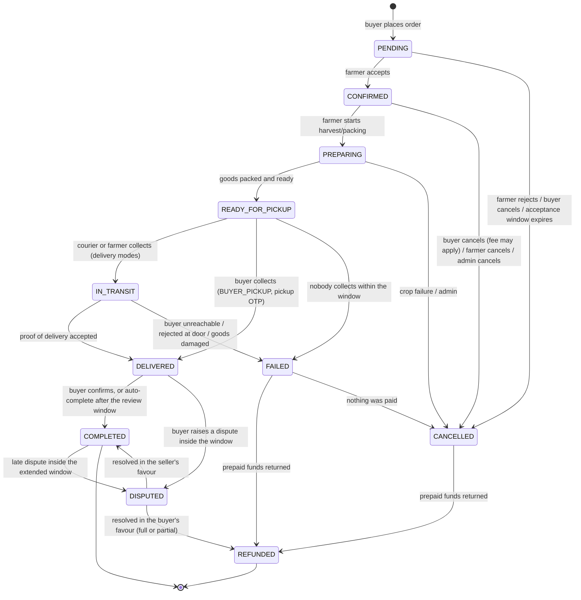

# 05 — Order System & State Machine

> **Status:** Approved 2026-08-10 (decisions D1–D10) · **Data:** [`02_DATABASE.md`](02_DATABASE.md) §8 · **Money effects:** [`06_FINANCIAL_ARCHITECTURE.md`](06_FINANCIAL_ARCHITECTURE.md)

---

## 1. Rules of the road

1. `OrderStatus` is an enum, and it is changed by **exactly one function**: `transition()` in `packages/domain/orders`. Assigning a status anywhere else is a review-blocking defect.
2. Every transition appends an immutable `OrderEvent`. The `orders.status` column is a **projection** of that log, kept for query performance.
3. Every transition declares: permitted actors, a guard, and effects (inventory, ledger, notifications). Effects run in the same database transaction as the state change; external side effects go through the outbox.
4. Transitions are idempotent. Replaying "confirm" on an already-confirmed order returns success with the current state — it does not error, and it does not double-post to the ledger.
5. No transition is triggered by the client asserting a status. The client requests an **action** (`accept`, `cancel`, `markReady`); the server decides the resulting state.

---

## 2. The state machine



### 2.1 Why `DISPUTED` is a hold state, not a lifecycle stage

The brief lists `DISPUTED` alongside `CANCELLED`/`FAILED`/`REFUNDED`. Operationally it behaves differently: a dispute arrives **after** delivery and its job is to **freeze settlement** until resolved. So `DISPUTED` is modelled as a reversible hold entered from `DELIVERED` or `COMPLETED`, whose only exits are `COMPLETED` or `REFUNDED`. Its practical effect is `settlementHold = true` on the seller's payable.

---

## 3. Transition table (normative)

| # | From → To | Actors | Guard | Effects |
|---|---|---|---|---|
| T1 | — → `PENDING` | BUYER | Valid unconsumed quote; stock reserved; buyer not suspended | Create order; `HELD` reservation; ledger `ORDER_PLACED`; set `acceptanceDeadline`; SMS seller |
| T2 | `PENDING` → `CONFIRMED` | FARMER, ADMIN | Now ≤ `acceptanceDeadline`; seller owns the order | Reservation → `COMMITTED`; `confirmedAt`; SMS buyer |
| T3 | `PENDING` → `CANCELLED` | FARMER (reject, reason required) | Seller owns the order | Release reservation; refund if prepaid; increment `ordersCancelledBySeller`; SMS buyer |
| T4 | `PENDING` → `CANCELLED` | BUYER | Buyer owns the order | Release reservation; full refund if prepaid; **no fee** |
| T5 | `PENDING` → `CANCELLED` | SYSTEM | Now > `acceptanceDeadline` | Reason `SELLER_TIMEOUT`; release reservation; full refund; reliability penalty; SMS both |
| T6 | `CONFIRMED` → `PREPARING` | FARMER | — | `preparingAt`; notify buyer |
| T7 | `CONFIRMED` → `CANCELLED` | BUYER | Before the cancellation cut-off (§5) | Release reservation; refund per policy; possible cancellation fee |
| T8 | `CONFIRMED`/`PREPARING` → `CANCELLED` | FARMER, ADMIN | Reason required | Release reservation; **full** buyer refund; reliability penalty; SMS buyer |
| T9 | `PREPARING` → `READY_FOR_PICKUP` | FARMER | Actual quantity recorded | `readyAt`; create/assign `Delivery`; notify ops or buyer |
| T10 | `READY_FOR_PICKUP` → `IN_TRANSIT` | OPS_AGENT, FARMER | Mode ∈ {`SELLER_DELIVERY`, `LANGGOL_DELIVERY`}; pickup confirmed | `Delivery.pickedUpAt`; generate delivery OTP; SMS buyer |
| T11 | `READY_FOR_PICKUP` → `DELIVERED` | FARMER, OPS_AGENT | Mode = `BUYER_PICKUP`; **pickup OTP from the buyer verified** | `deliveredAt`; capture COD if applicable; ledger `GOODS_DELIVERED` |
| T12 | `READY_FOR_PICKUP` → `FAILED` | SYSTEM, ADMIN | Collection window elapsed | Reason `NOT_COLLECTED`; release/settle per §6 |
| T13 | `IN_TRANSIT` → `DELIVERED` | OPS_AGENT, FARMER | **Delivery OTP verified** or photo proof + ops confirmation | `deliveredAt`; final quantity + adjustment; COD capture; ledger `GOODS_DELIVERED` |
| T14 | `IN_TRANSIT` → `FAILED` | OPS_AGENT, ADMIN | Reason required | `Delivery.status = FAILED`; refund if prepaid; record cost of the wasted trip |
| T15 | `DELIVERED` → `COMPLETED` | BUYER | — | `completedAt`; release settlement hold; invite review |
| T16 | `DELIVERED` → `COMPLETED` | SYSTEM | Review window elapsed with no dispute (default 48 h) | Same as T15 |
| T17 | `DELIVERED`/`COMPLETED` → `DISPUTED` | BUYER | Inside the dispute window (default 72 h from delivery) | `settlementHold = true`; open `Dispute`; notify seller + ops |
| T18 | `DISPUTED` → `COMPLETED` | ADMIN | Dispute resolved, no refund | Release hold; record resolution |
| T19 | `DISPUTED` → `REFUNDED` | ADMIN | Dispute resolved with refund | Refund (full/partial); ledger reversal; adjust settlement |
| T20 | `CANCELLED`/`FAILED` → `REFUNDED` | SYSTEM, ADMIN | Prepaid amount > 0 | Refund via provider; ledger `REFUND` |

**Illegal transitions** (`DELIVERED` → `PREPARING`, `COMPLETED` → `CANCELLED`, `CANCELLED` → anything but `REFUNDED`, …) are rejected with a typed `IllegalTransition` error and logged as a security-relevant event — a client attempting one is either broken or probing.

**Fault is mandatory on T3, T5, T7, T8, T12, T14, T19 and T20.** Any transition into `CANCELLED`, `FAILED` or `REFUNDED` must supply a `FaultParty` (§5.1). The domain function will not construct the transition without one, and the database will not store the resulting row without one.

---

## 4. Timers and windows

All configurable in `PlatformConfig`, all versioned.

| Timer | Default | Notes |
|---|---|---|
| Acceptance window | 2 h, **quiet-hours aware** | An order placed at 22:40 must not auto-cancel at 00:40 because the farmer is asleep. Quiet hours 21:00–07:00 Asia/Dhaka do not consume the window |
| Quote TTL | 15 min | §8 of [`04_MARKETPLACE.md`](04_MARKETPLACE.md) |
| Reservation TTL | acceptance window + 10 min | Grace against clock skew |
| Preparation SLA | 24 h from confirm (crop-dependent) | Breach → ops alert, not auto-cancel: harvest is weather-dependent |
| Collection window | 24 h from `READY_FOR_PICKUP` | Then `FAILED` |
| Auto-complete | 48 h after delivery | If no dispute |
| Dispute window | 72 h after delivery | Highly perishable goods: 24 h — the evidence rots |
| **Settlement hold** | **by farmer risk tier: `TRUSTED` T+0, `STANDARD` T+1, `NEW` longer** | Measured from successful delivery, not from `COMPLETED` — see §4.1 |

### 4.1 T+0/T+1 settlement versus the 72-hour dispute window

These two are in genuine tension, and the approved decision (D5) resolves it in the farmer's favour: **settlement targets T+0/T+1 after successful delivery**, which means most farmers are paid *before* the dispute window closes.

The consequence is accepted deliberately: a dispute upheld after payout becomes a **clawback** against the farmer's next settlement ([`06_FINANCIAL_ARCHITECTURE.md`](06_FINANCIAL_ARCHITECTURE.md) §5.6), not a delayed payment for every farmer. Paying 100 farmers three days late to protect against two disputes is a bad trade — late payment is the single fastest way to lose farmer trust in this market ([`08_BANGLADESH_CONTEXT.md`](08_BANGLADESH_CONTEXT.md) §6).

Exposure is managed rather than eliminated:

- **Risk tiers.** `NEW` farmers carry a longer hold until a track record exists; `TRUSTED` farmers settle same-day
- **Hard holds** regardless of tier: an open dispute, a payout-account change inside the cooling period, or a fraud flag
- **Reconciliation gate.** COD settlement waits on the agent's cash actually being reconciled — we do not pay out against cash we cannot confirm was collected
- **Clawback ceiling.** Unrecovered clawbacks beyond a threshold route to ops for a human conversation, never to automated collection

*Open decision Q2: the exact hold hours per tier.*

The quiet-hours rule is not a nicety. Auto-cancelling overnight orders would produce a wave of `SELLER_TIMEOUT` cancellations, a collapse in measured reliability, and farmers concluding the platform punishes them for sleeping.

---

## 5. Cancellation policy

| Who | State | Fee | Refund | Reliability impact |
|---|---|---|---|---|
| Buyer | `PENDING` | None | Full | None |
| Buyer | `CONFIRMED` (< 1 h, nothing harvested) | None | Full | Soft counter |
| Buyer | `PREPARING` / after harvest started | Cancellation fee (config; default a % of subtotal, floor and cap applied) | Total − fee | Counted; repeated abuse → restriction |
| Buyer | `READY_FOR_PICKUP` or later | Not permitted — becomes a dispute or a refusal at delivery | Per dispute outcome | — |
| Farmer | Any pre-delivery state | None charged | Full to buyer | **Yes** — the primary reliability signal |
| Admin | Any pre-delivery state | Discretionary | Discretionary, reason mandatory | Recorded, not automatically penalised |
| System | `PENDING` timeout | None | Full | Yes, seller-side |

### 5.1 Fault attribution (normative)

Every cancellation, failure and dispute resolution carries an explicit `FaultParty`. It is a required input to the domain function, not a reporting label added afterwards, and the database rejects a terminal non-happy state without it ([`02_DATABASE.md`](02_DATABASE.md) §12).

| `FaultParty` | Meaning | Typical consequence |
|---|---|---|
| `BUYER` | Buyer changed their mind, was absent, refused without cause | Cancellation fee may apply; fee goes to the farmer (§5.2) |
| `SELLER` | Farmer rejected, no-showed, sent substandard or short goods | Full buyer refund; reliability penalty; seller bears any refund |
| `PLATFORM` | Our software, our pricing error, our ops mistake | We bear the cost; no penalty to either party; `subsidyReason = OPS_ERROR` |
| `LOGISTICS` | Damage or failure in transit under our coordination | Platform bears it (`5030` spoilage and loss) |
| `FORCE_MAJEURE` | Flood, cyclone, road closure, crop failure from weather | No fee, no penalty, full refund. **Weather is not dishonesty** |
| `UNDETERMINED` | Genuinely unclear after review | No fee charged, no reliability penalty. Ambiguity resolves in the user's favour, not ours |

`UNDETERMINED` defaulting to no-penalty is deliberate. A system that penalises whenever it cannot tell will, over a season, systematically punish the party with less ability to document their case — which in this market is the farmer.

### 5.2 Where the cancellation fee goes (approved decision D7)

**Default destination: the farmer.** When a cancellation is attributable to the buyer and produce has been harvested, picked or committed, the fee compensates the farmer.

```text
cancellationFee            = feeSchedule(state, subtotal)        // config, versioned
cancellationFeeToPlatform  = documented operational cost component, if any  // config, default 0
cancellationFeeToFarmer    = cancellationFee − cancellationFeeToPlatform

invariant: cancellationFeeToFarmer + cancellationFeeToPlatform == cancellationFee   [DB CHECK]
```

Rules:

1. Langgol may retain **only** an explicitly documented operational-cost component — a wasted trip already dispatched, a payment fee already incurred. That component is configured, disclosed, and separately reported. It is a cost recovery, not a revenue line.
2. The residual always goes to the farmer, credited to their payable and settled normally.
3. **Langgol does not profit from buyer regret at the farmer's expense.** If the operational component ever exceeds the fee, the excess is a platform cost, not a farmer deduction.
4. No fee at all where fault is `FORCE_MAJEURE`, `PLATFORM`, `LOGISTICS` or `UNDETERMINED`.

*Open decision Q3: the fee schedule itself, and the size of the permitted operational component.*

---

## 6. Money effects by terminal state

| Terminal state | COD (live at launch) | Prepaid (built, not enabled) |
|---|---|---|
| `CANCELLED` before delivery | Nothing collected; cancellation fee (if any) allocated per §5.2 | Refund in full less any fee; reverse commission |
| `FAILED` at delivery | Nothing collected; **the wasted trip cost is real** and is booked to the trip, then to a platform expense attributed by `faultParty` | Refund in full; trip cost booked |
| `COMPLETED` | Cash collected by courier/agent → agent float → platform; farmer payable settled net of commission at T+0/T+1 | Gateway settlement → platform; farmer payable settled net |
| `REFUNDED` (partial) | Partial cash refund or adjustment; borne by whoever `faultParty` names | Partial refund via provider; commission adjusted pro-rata |

Journal entries for each are specified in [`06_FINANCIAL_ARCHITECTURE.md`](06_FINANCIAL_ARCHITECTURE.md) §5. Two points worth stating here because they are routinely missed:

- **A failed delivery is not free.** The vehicle moved. The cost lands on the `DeliveryTrip` and is allocated like any other, then attributed by `faultParty`. If it is not recorded, contribution margin is overstated and every strategic decision downstream is wrong.
- **COD means Langgol handles other people's cash.** The float sitting in a courier's pocket is a real asset with a real owner and it must appear on the balance sheet, with per-agent reconciliation. See §7.1 of [`08_BANGLADESH_CONTEXT.md`](08_BANGLADESH_CONTEXT.md) on why this is also a regulatory matter.

### 6.1 Trips, delivery models and measurement

An order's `Delivery` names its `deliveryModel` (`INDIVIDUAL`, `AGGREGATED_ROUTE`, `RETAILER_BULK`, `PICKUP`) and, unless it is a pickup, points at a `DeliveryTrip`. Cost is recorded once on the trip and allocated to its orders by a recorded method ([`10_ECONOMIC_MEASUREMENT.md`](10_ECONOMIC_MEASUREMENT.md) §6.3).

**A trip must be costed before its orders can be measured.** `economics:compute` waits for it rather than substituting an estimate, and uncosted completed trips appear on the ops queue daily. An estimate quietly standing in for a measurement would corrupt the one number this pilot exists to produce.

---

## 7. Edge cases that must be designed, not discovered

| Case | Handling |
|---|---|
| **Delivered weight ≠ ordered weight** | Within tolerance (default ±5%): auto-adjust `lineTotal` by actual weight, recompute commission, show the buyer the adjustment. Outside tolerance: buyer must confirm at the door, otherwise dispute |
| **Partial delivery** (30 of 50 kg) | Deliver what exists; adjust the order to actual; refund/never-charge the balance; seller reliability recorded. Never silently deliver less and charge full |
| **Buyer absent** | Two contact attempts logged → `FAILED(BUYER_UNAVAILABLE)`. Perishables cannot wait: ops may authorise resale or disposal, recorded as a loss with the reason |
| **Farmer no-show at pickup** | `FAILED(SELLER_NO_SHOW)`; buyer refunded; strong reliability penalty; repeated → suspension |
| **Quality rejected at the door** | Buyer may refuse; goods return or are disposed; `FAILED(QUALITY_REJECTED)` opens a dispute with mandatory photo evidence from the courier |
| **Duplicate order submission** | Same idempotency key returns the same order. Different key, same quote → rejected, because the quote is single-use |
| **Two buyers, last crate** | Atomic conditional `UPDATE` decides ([`02_DATABASE.md`](02_DATABASE.md) §13); the loser sees "just sold out" with alternatives, never a silent failure |
| **Farmer edits the listing after an order** | Orders hold snapshots; live edits never affect placed orders. Price/quantity edits are blocked while `HELD`/`COMMITTED` reservations exist |
| **Payment webhook arrives twice / out of order** | `Payment.providerRef` unique; webhook handler is idempotent and tolerates out-of-order arrival by comparing provider state, not assuming sequence |
| **COD cash not remitted by agent** | Agent float account goes negative-in-our-favour; daily reconciliation report; settlement to the farmer is **not** blocked by our collection failure — that risk is ours, not the farmer's |
| **Crop fails after confirmation** | Farmer cancels with reason `CROP_FAILURE`. Distinguished from ordinary cancellation in reliability scoring — weather is not dishonesty |
| **Buyer disputes after auto-complete** | Allowed inside the extended window; settlement may already have paid out, so recovery is a clawback (`SettlementItem type = REFUND_CLAWBACK`), never a silent negative balance |

---

## 8. Notifications per transition

SMS is the primary channel: it reaches feature phones, survives no-data, and is what rural users actually check. In-app is secondary.

| Event | Buyer | Farmer | Ops |
|---|---|---|---|
| Order placed | SMS + in-app | **SMS + in-app (urgent)** | — |
| Accepted / rejected | SMS | — | — |
| Ready | SMS | — | SMS (dispatch) |
| Picked up / in transit | SMS + delivery OTP | — | — |
| Delivered | SMS | SMS (earnings) | — |
| Cancelled (any) | SMS + reason | SMS + reason | Alert if system-triggered |
| Dispute raised | ack | SMS | Alert |
| Settlement paid | — | SMS with amount | — |

All templates are bilingual, chosen by `User.preferredLanguage`, and dispatched via the outbox so a state change is never lost because an SMS gateway was down.

---

## 9. Testing requirements (merge-blocking)

- Every cell of the §3 table: allowed transitions succeed, all others fail with `IllegalTransition`
- Every transition, executed twice: identical final state, exactly one ledger transaction
- Concurrency: two simultaneous orders on the last unit — exactly one succeeds
- Timer sweeps: acceptance expiry (including quiet hours), reservation release, auto-complete
- Money: for a sample of orders across every terminal state, `sum(debits) == sum(credits)` and the farmer's payable equals `sellerGross − commission ± adjustments`
- Authorization: every action attempted by a non-owner of the correct role must fail
- **Fault attribution:** every terminal non-happy transition rejects a missing `FaultParty`; each fault value routes cost to the correct bearer
- **Cancellation fee allocation:** fee always splits exactly between farmer and platform components; farmer share is never negative; no fee under `FORCE_MAJEURE`/`PLATFORM`/`LOGISTICS`/`UNDETERMINED`
- **Settlement timing:** T+0/T+1 eligibility by risk tier; hard holds (open dispute, payout change, fraud flag, unreconciled COD) block payout; clawback after payout nets correctly against the next settlement
- **Delivery funding:** each of the six models produces a split summing to the tariff; subsidising models are refused without a reason or with an exhausted budget
- Full E2E: list → discover → quote → order → accept → prepare → deliver → complete → **trip costed → economics computed** → settle
